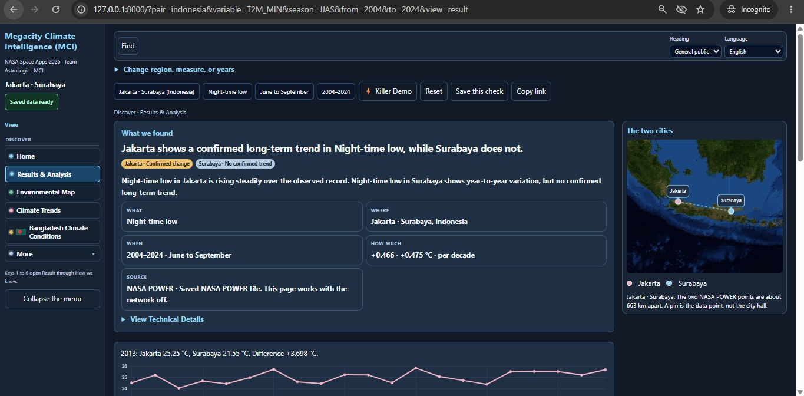
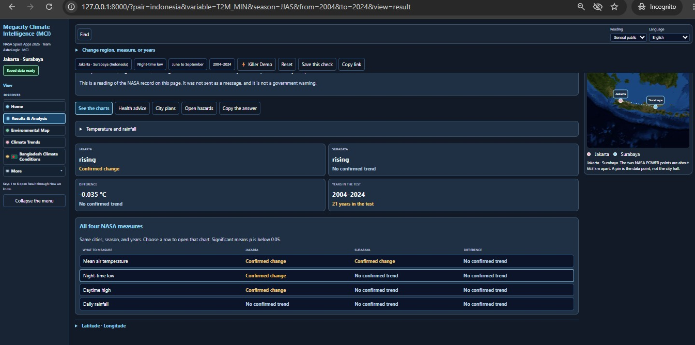
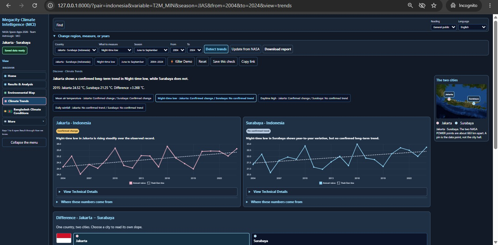
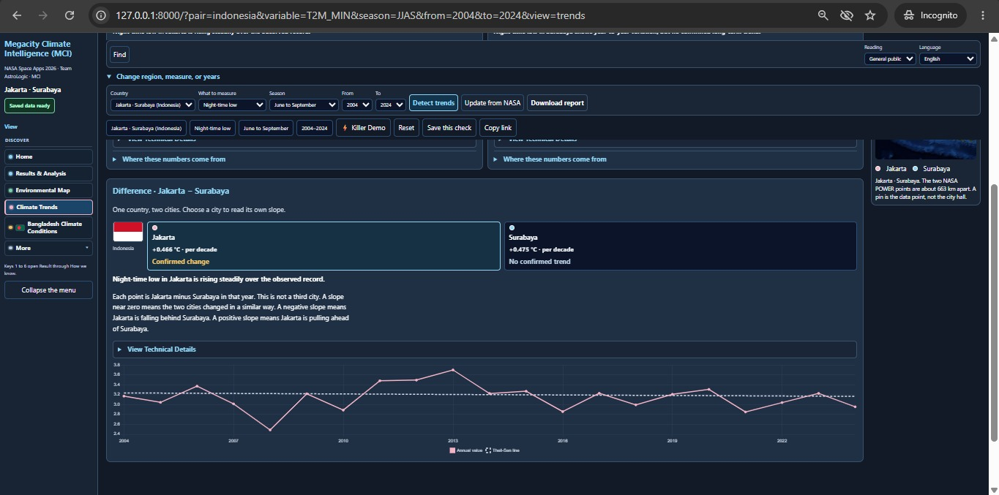
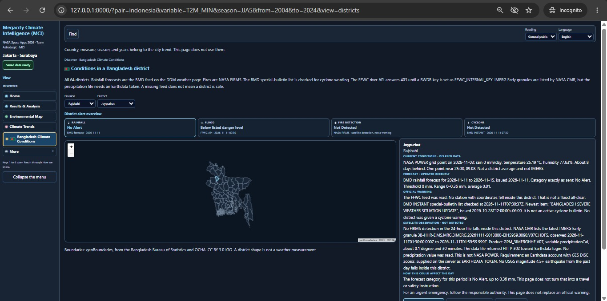
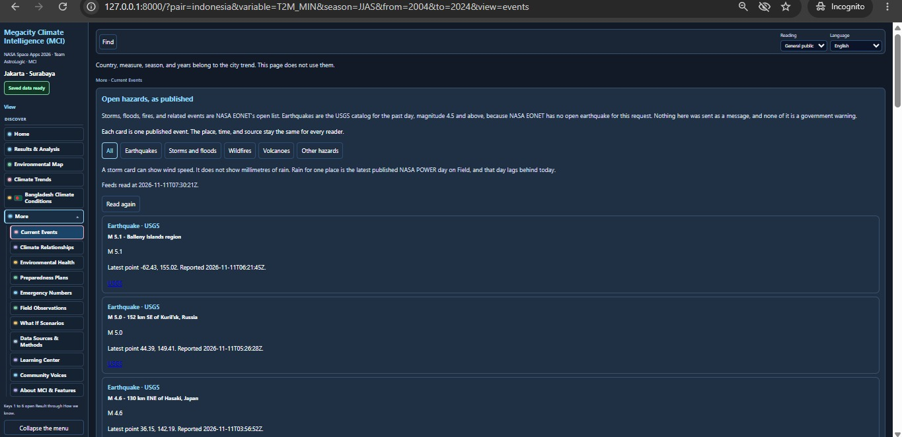
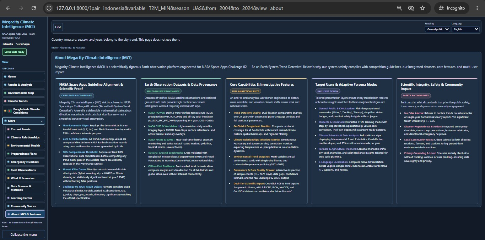

# Megacity Climate Intelligence (MCI)

> **NASA International Space Apps Challenge 2026**  
> **Challenge:** *Be an Earth System Trend Detective*  
> **Team:** Team AstroLogic  
> **Platform Name:** Megacity Climate Intelligence (MCI)<br>
> **Overall Project Overview (Drive Video Link):** https://drive.google.com/file/d/1cqLivEyvOzLIHE2nU7Fx1IITtAuyN7Pr/view?usp=sharing> ** 
> **240 s Youtube Video Link:** https://youtu.be/7Bc2XX1VSTE
>  [**Note:** This video was created with the assistance of AI tools.]

>**AI Tools Used:**
>- **Claude Opus 5.5** — Video generation and creative assistance
>- **ElevenLabs AI** — Speech generation
>- **Gemini 4 Argon** — Overall Idea
---

## 🌍 Executive Summary

**Megacity Climate Intelligence (MCI)** is a scientifically defensible Earth observation analysis platform engineered for the **NASA Space Apps Challenge 2026: Be an Earth System Trend Detective**.

In climate science, a **trend is not just a smoothed graph or a visual impression**; it is an empirical claim about **direction**, **magnitude**, and **statistical significance**. MCI empowers civic leaders, city planners, researchers, students, and citizens to investigate climate shifts across global megacities and national territories with mathematical rigor.

By applying deterministic non-parametric statistics (**Mann-Kendall rank tests** and **Theil-Sen robust slope estimation** with annual 95% confidence intervals) over 24+ years of NASA Earth observation records, MCI eliminates subjective interpretation and guarantees **zero AI hallucinations in all numerical claims**.

---

## 🎯 Key Capabilities & Features

### 1. 🔍 Trend Detective Engine
- **Decadal Multi-City Analysis:** Compares paired cities within the same country over 2001–2025 across four primary environmental parameters:
  - Daily Mean Temperature at 2m (`T2M`)
  - Night-time Minimum Temperature (`T2M_MIN`)
  - Daytime Maximum Temperature (`T2M_MAX`)
  - Corrected Total Precipitation (`PRECTOTCORR`)
- **Supported Global Megacity Pairs:**
  - 🇧🇩 **Bangladesh:** Dhaka vs. Sylhet
  - 🇮🇳 **India:** Delhi vs. Kolkata
  - 🇮🇩 **Indonesia:** Jakarta vs. Surabaya
  - 🇪🇬 **Egypt:** Cairo vs. Alexandria
  - 🇳🇬 **Nigeria:** Lagos vs. Abuja
- **The "Killer Demo" Contrast:** Directly showcases two contrasting real-world trends side-by-side (e.g. *Sylhet* showing significant warming at $p = 0.0497$ vs. *Dhaka* showing unconfirmed warming at $p = 0.1941$) without forcing false positives.
- **Challenge 02 JSON Result Object:** Fully compliant with NASA's Challenge 02 audit object specification (`district`, `variable`, `period`, `n_observations`, `tau`, `p_value`, `slope_per_decade`, `direction`, `significance`).

### 2. 🇧🇩 64-District Bangladesh Climate Monitor
- Full territorial coverage of all 64 administrative districts of Bangladesh.
- Interactive boundary map with regional ranking tables, spatial heatmaps, and quick filtering (All, Significant, Cooling, Warming, Steady).
- Real-time cross-validation with **BMD (Bangladesh Meteorological Department)** rainfall forecasts & cyclone bulletins and **FFWC (Flood Forecasting and Warning Centre)** river water level warnings.

### 3. 📈 Climate Relationships (Bivariate Correlation Matrix)
- Simultaneous calculation of paired annual **Pearson ($r$)** and **Spearman ($\rho$)** rank correlations with two-sided Student's $t$ significance tests (`src/compute/correlate.py`).
- Explores dynamics across Temperature vs. Rainfall, Night Low vs. Day High, and Solar Radiation.
- Interactive scatter plots with robust linear trend fits and plain-language relationship summaries.

### 4. 🎛️ Environmental Trend Snapshot (Filters & Scoping)
- Single-city filter dropdown and custom year-range slider (2001–2025) on the Home dashboard.
- Displays mean values, trends, and net change per decade for the chosen timeframe.

### 5. 👥 Adaptive Persona Reading Modes
- **General Public / City Officer:** Plain-language verdicts ("Rising", "Cooling", "Steady"), simplified status badges, and practical action insights without jargon.
- **Student & Educator:** Interactive STEM learning mode with progressive statistical explanations ($p$-values, rank correlations, Theil-Sen median slopes).
- **Climate Scientist:** Complete mathematical rigor ($S$, $Z$, $\tau$, Sen slope per year/decade, 95% confidence bounds, and raw data audit).
- **Farmer / Agricultural Planner:** Seasonal monsoon trends, rainfall anomalies, and solar irradiance patterns for crop calendar planning.

### 6. 🛡️ Data Transparency & Provenance Drawer
- Total observation count visibility ($N = 7671\text{ days}$).
- **80% Completeness Rule:** A year is excluded if missing more than 20% of its expected days; data gaps are explicitly listed rather than interpolated or hidden.
- Real-time display of the exact Challenge 02 JSON Result Object.

### 7. 📤 Dual-Tier Multi-Format Scientific Export
- **General Public:** Clean, high-resolution one-click **PDF** and **PNG** report generation.
- **Researchers & Students (More Formats):** Full programmatic datasets in **CSV**, **JSON**, **NetCDF**, **GeoJSON**, **TXT**, and **HTML**.

---

## 🛰️ Data Provenance & Sources

MCI uses open, defensible Earth observation data from NASA and authenticated ground institutions without requiring external API keys:

| Dataset / Source | Source Entity | Parameters / Coverage | Purpose in MCI |
| :--- | :--- | :--- | :--- |
| **NASA POWER** | NASA Langley Research Center | Daily Point API: `T2M`, `T2M_MIN`, `T2M_MAX`, `PRECTOTCORR`, `ALLSKY_SFC_SW_DWN` (2001–2025) | Core non-parametric trend engine & historical time-series |
| **NASA GIBS** | NASA EOSDIS | Global Imagery Browse Services (Blue Marble, MODIS Terra/Aqua Surface Reflectance) | Interactive satellite map imagery & thermal overlays |
| **NASA FIRMS** | NASA Earthdata | Near-real-time active fire & thermal anomaly detections | Ground hazard monitoring and wildland fire tracking |
| **NASA EONET** | NASA Earth Observatory | The Earth Observatory Natural Event Tracker (v3) | Natural hazard alerts (severe storms, cyclones, floods) |
| **USGS** | U.S. Geological Survey | Real-time past-day seismic feed | Regional earthquake event tracking |
| **BMD & FFWC** | Govt. of Bangladesh | Ground meteorological stations & flood warning gauges | National ground-truth calibration for Bangladesh |

*Detailed source capabilities and constraints are documented in [docs/DATA_SOURCES.md](docs/DATA_SOURCES.md).*

---

## 🌐 Multilingual Support (6 Languages)

MCI features native localization across 6 languages with adaptive layout direction:

- 🇬🇧 **English (en)**
- 🇧🇩 **Bangla (bn)** — *বাংলা*
- 🇮🇳 **Hindi (hi)** — *हिन्दी*
- 🇮🇩 **Indonesian (id)** — *Bahasa Indonesia*
- 🇸🇦 **Arabic (ar)** — *العربية (Native Right-to-Left RTL support)*
- 🇳🇬 **Yoruba (yo)** — *Èdè Yorùbá*

---

## ⚡ Offline-First Architecture

MCI is engineered for mission-critical reliability during field deployments or power/internet outages:
- Pre-bundled historical NASA POWER series in `demo_fixtures/` and cached regional boundaries in `web/world_data.js`.
- If the network is unavailable, MCI gracefully operates entirely offline: calculations, trend graphs, and maps function without interruption.
- Live hazards and external feeds report clear status rather than fabricating unverified data.

---

## 🚀 Quickstart Guide

### Prerequisites
- Python 3.10+
- Modern Web Browser (Chrome, Firefox, Edge, Safari)

### Installation & Run

```bash
# 1. Clone repository
git clone https://github.com/TanvirHosenNishat01-blip/AstroLogic.git
cd AstroLogic

# 2. Setup virtual environment
python -m venv venv

# Windows:
venv\Scripts\activate
# Linux / macOS:
# source venv/bin/activate

# 3. Install dependencies
pip install -r requirements.txt

# 4. Start the server
python -m src.api.main
```

Open your browser at **`http://127.0.0.1:8000`**.

### Offline Simulation Mode
To run the server in strict offline mode (preventing all outbound requests and serving local data):

```powershell
# Windows PowerShell:
$env:OFFLINE="1"; python -m src.api.main

# Windows CMD:
set OFFLINE=1 && python -m src.api.main

# Linux / macOS:
OFFLINE=1 python -m src.api.main
```

### Cache Refresh
To refresh local city fixtures from the live NASA POWER API:

```bash
python -m src.acquire.build_cache
```

---

## 🧪 Testing

MCI includes a comprehensive unit testing suite covering trend statistics, correlation matrices, data alignment, gap filtering, boundary containment, and hazard processors:

```bash
python -m unittest discover -s tests -v
```

*All 29 tests run deterministically in under 0.3s.*

---

## 📁 Repository Structure

```
AstroLogic/
├── .env.example                               # Environment variable template
├── .gitignore                                 # Git untracked and ignored files configuration
├── AGENTS.md                                  # Autonomous agent loop and developer guide
├── CLAUDE.md                                  # Project architecture and coding guidelines
├── LICENSE                                    # Open source license (MIT)
├── README.md                                  # Main project documentation (MCI overview, setup, API)
├── requirements.txt                           # Python dependencies manifest
│
├── cache/                                     # Local runtime cache for live fetched satellite data
│   └── .gitkeep
│
├── data/                                      # Runtime application storage and local database
│   ├── cities/                                # Pre-processed climatological baseline metrics
│   │   ├── abuja.json
│   │   ├── alexandria.json
│   │   ├── cairo.json
│   │   ├── delhi.json
│   │   ├── dhaka.json
│   │   ├── jakarta.json
│   │   ├── kolkata.json
│   │   ├── lagos.json
│   │   ├── surabaya.json
│   │   └── sylhet.json
│   └── voices.json                            # Citizen-science and community observation records
│
├── demo_fixtures/                             # Offline NASA POWER 24-year (2001–2025) historical series
│   ├── power_abuja.json
│   ├── power_alexandria.json
│   ├── power_cairo.json
│   ├── power_delhi.json
│   ├── power_dhaka.json
│   ├── power_jakarta.json
│   ├── power_kolkata.json
│   ├── power_lagos.json
│   ├── power_surabaya.json
│   ├── power_sylhet.json
│   └── sample_power.json
│
├── docs/                                      # NASA Space Apps dossier and verification documentation
│   ├── AI_USE.md                              # Ethical disclosure and AI assistant utilization record
│   ├── AstroLogic-meeting-5-Nov-2026.pdf      # Team sprint and design log (PDF)
│   ├── DATA_SOURCES.md                        # Exhaustive NASA & national Earth Observation provenance guide
│   ├── PROJECT_PAGE.md                        # Official NASA Space Apps submission draft
│   └── meeting-2026-11-05.html                # Team deliberation minutes (HTML)
│
├── src/                                       # Backend Python services and computational core
│   ├── acquire/                               # Live ingestion, telemetry parsing, and offline fallbacks
│   │   ├── __init__.py
│   │   ├── build_cache.py                     # NASA POWER cache generation script
│   │   ├── district_alert.py                  # 64-district live telemetry (FIRMS, BMD, FFWC)
│   │   └── safe.py                            # Offline boundary guards and zero-hallucination validation
│   ├── agents/                                # Autonomous climate investigation pipeline
│   │   ├── __init__.py
│   │   └── loop.py
│   ├── api/                                   # FastAPI web service and endpoints
│   │   ├── __init__.py
│   │   └── main.py                            # REST API, Challenge 02 JSON Result Object & export routes
│   └── compute/                               # Deterministic statistical engines (Challenge 02)
│       ├── __init__.py
│       ├── correlate.py                       # Bivariate Pearson (r) & Spearman (rho) correlation matrix
│       └── trend.py                           # Non-parametric Mann-Kendall test & Theil-Sen slope estimator
│
├── tests/                                     # Automated test suite (29 tests, 100% passing)
│   ├── test_correlate.py                      # Correlation coefficients and Student's t-test verification
│   ├── test_district_alert.py                 # District geo-containment, flood, and fire alert tests
│   ├── test_records.py                        # City series isolation and data integrity tests
│   └── test_trend.py                          # Mann-Kendall statistics, p-values, and Sen slope tests
│
└── web/                                       # Frontend Single Page Application (SPA)
    ├── .gitkeep
    ├── app.js                                 # Client state, routing, Chart.js views, and filter controls
    ├── bd_districts.geojson                   # High-precision GeoJSON boundaries for all 64 BD districts
    ├── chart.umd.min.js                       # Chart.js visualization engine
    ├── countries.geojson                      # Global administrative territory boundaries
    ├── districts.js                           # 64-district bilingual catalog and division mapping
    ├── helplines.js                           # Official national and regional emergency helplines
    ├── i18n.js                                # 6-language translation catalog (EN, BN, HI, ID, AR, YO)
    ├── index.html                             # Semantic HTML5 layout and application shell
    ├── leaflet.css                            # Cartographic mapping UI styles
    ├── leaflet.js                             # Leaflet interactive map library
    ├── places.js                              # Global megacity metadata and comparative pair definitions
    ├── report_extra.js                        # Multi-format scientific report generation engine
    ├── style.css                              # Responsive glassmorphism theme, card grid, and RTL styles
    └── world_data.js                          # Offline global continental and shoreline geometries
```

---


---

## 📸 Project Screenshots

Explore the user interface and core functionalities of **Megacity Climate Intelligence (MCI)**, developed by **Team AstroLogic** for the **NASA International Space Apps Challenge 2026**.

### 🏠 1. Home Dashboard & Live Earth Alerts

The main dashboard introduces the MCI platform and provides quick access to climate investigations, Earth observation trends, environmental maps, and real-time natural hazard information.


---

### 🔍 2. Climate Investigation & Results Overview

The Results & Analysis interface presents scientifically validated climate trend findings, including statistical significance, temperature changes, observation periods, and NASA data sources.



---

### 📊 3. Environmental Analysis & Climate Indicators

A comprehensive analytical overview comparing multiple NASA POWER environmental parameters, including mean air temperature, night-time minimum temperature, daytime maximum temperature, and daily precipitation.



---

### 📈 4. Historical Climate Trends & City Comparisons

Interactive climate trend visualizations comparing Jakarta and Surabaya, Indonesia. The platform displays historical temperature observations, long-term trend lines, and statistically confirmed or unconfirmed changes.



---

### 🌡️ 5. Comparative Climate Difference Analysis

A detailed comparison of climate trends between two megacities, highlighting differences in observed temperatures, annual variability, and long-term changes.



---

### 🇧🇩 6. Bangladesh District-Level Climate Monitoring

An interactive geographical monitoring interface providing district-level environmental information across Bangladesh, including rainfall forecasts, flood conditions, fire detection, and cyclone bulletins.



---

### 🚨 7. Natural Disasters & Real-Time Hazard Monitoring

The Current Events dashboard integrates published hazard information from NASA EONET and USGS, allowing users to explore earthquakes, severe storms, floods, wildfires, volcanic activity, and other environmental events.



---

### 🛰️ 8. Platform Architecture, Scientific Integrity & Core Features

An overview of the MCI platform's scientific methodology, NASA challenge alignment, Earth observation data sources, investigative capabilities, adaptive user experiences, and commitment to data transparency.



---

**Developed by Team AstroLogic | NASA International Space Apps Challenge 2026**

*Be an Earth System Trend Detective — Transforming Earth observation data into meaningful climate insights.*

## ⚖️ Scientific Integrity & Ethics

- **Zero AI in Calculations:** Neither large language models nor predictive AI generate numerical claims. All calculations stem from peer-reviewed statistical algorithms (Mann 1945, Kendall 1975, Sen 1968, Gilbert 1987).
- **Public Safety:** Health guidelines and disaster steps are explicitly marked as practical reference notes, never represented as official government evacuation orders.
- **Privacy First:** MCI runs locally with zero tracking cookies, user profiling, or third-party advertising scripts.

---


---


---

## 📜 License & Usage Rights

### MIT Open-Source License

**Megacity Climate Intelligence (MCI)** is an open-source
project developed by **Team AstroLogic** for the
**NASA International Space Apps Challenge 2026**.

The software is distributed under the **MIT License**,
a permissive open-source license that encourages
collaboration, research, innovation, and responsible
software development.

For the complete legal terms, please refer to the
[LICENSE](LICENSE) file included in this repository.

### 1. Permissions and Allowed Usage

Under the MIT License, users are permitted to:

- **Use:** Run and utilize the software for personal,
  educational, academic, research, or commercial purposes.

- **Modify:** Modify, improve, or extend the source code
  to develop additional functionalities.

- **Distribute:** Share original or modified copies of
  the software with others.

- **Commercial Use:** Incorporate the software into
  commercial products or services.

- **Private Use:** Use the software within private
  organizations or internal research projects.

- **Research and Education:** Use the platform to study
  environmental trends, climate statistics, Earth
  observation data, and scientific visualization.

### 2. License Conditions

Anyone using, modifying, or distributing this software
must comply with the following requirements:

- Preserve the original copyright notice.
- Include the MIT License text in copies or substantial
  portions of the software.
- Respect applicable licenses and usage conditions of
  third-party dependencies, datasets, and resources.
- Avoid representing modified versions as official
  releases of Team AstroLogic without authorization.

**Note:** The final two points are project guidance
and are not additional conditions of the MIT License.

### 3. Third-Party Data Sources and Attribution

MCI integrates publicly accessible Earth observation,
meteorological, and environmental information from
several independent scientific organizations.

These sources include:

| Data Provider | Purpose |
|---|---|
| NASA POWER | Historical temperature, rainfall, and solar radiation observations |
| NASA GIBS | Satellite imagery and Earth observation visualization |
| NASA FIRMS | Active fire and thermal anomaly observations |
| NASA EONET | Published natural hazard events |
| USGS | Earthquake and seismic activity information |
| Bangladesh Meteorological Department (BMD) | Weather forecasts and cyclone bulletins |
| Flood Forecasting and Warning Centre (FFWC) | River monitoring and flood-related information |

The MIT License applies to the original software
distributed by this project.

It does not automatically grant ownership of,
or additional rights to, external datasets,
satellite imagery, trademarks, institutional
logos, or third-party software components.

Users must follow the applicable attribution,
licensing, and redistribution requirements
of the respective data providers.

The inclusion of data from NASA or any other
organization does not imply endorsement,
certification, or official partnership.

### 4. Scientific and Statistical Disclaimer

MCI provides climate information through
computational analysis of environmental observations.

The platform uses established statistical methods,
including:

- Mann–Kendall trend significance testing
- Theil–Sen slope estimation
- Pearson correlation analysis
- Spearman rank correlation analysis

Analytical results depend on data availability,
quality, temporal coverage, geographic scope,
and the selected statistical assumptions.

A statistically significant trend does not, by
itself, establish the cause of that trend.

Although the platform emphasizes transparent
and reproducible methods, the accuracy,
completeness, and suitability of individual
results cannot be guaranteed for every use case.

Users should independently verify important
scientific findings before relying on them
for research, policy, or operational decisions.

### 5. Public Safety and Emergency Disclaimer

MCI is designed for environmental research,
education, climate awareness, and decision support.

**It is not an official disaster warning,
emergency response, or evacuation system.**

The platform may display information about:

- Earthquakes
- Flood conditions
- Wildfires and thermal anomalies
- Severe storms and cyclones
- Rainfall and temperature conditions

Such information may be delayed, incomplete,
or unavailable depending on the source.

For emergency decisions, users should consult
the relevant government agencies and authorized
emergency management authorities.

### 6. Software Warranty and Liability

The software is provided **"AS IS"**, without
warranty of any kind, express or implied.

The copyright holders and contributors are not
liable for claims, damages, or other liabilities
arising from the use of the software, subject
to applicable law.

The legally controlling warranty disclaimer
and limitation of liability are contained in
the [LICENSE](LICENSE) file.

### 7. Contributions and Community Development

Team AstroLogic welcomes constructive contributions
that improve the platform's functionality,
accessibility, scientific transparency,
documentation, and reliability.

Contributors are encouraged to:

- Follow the project's existing coding conventions.
- Document substantial modifications.
- Reference appropriate scientific data sources.
- Test changes before submitting pull requests.
- Respect third-party intellectual property rights.
- Maintain transparency in scientific calculations.

Contributions are subject to the project's
applicable licensing arrangements.

### 8. Project Attribution

**Project:** Megacity Climate Intelligence (MCI)

**Developed by:** Team AstroLogic

**Competition:** NASA International Space Apps
Challenge 2026

**Challenge:** Be an Earth System Trend Detective

**License:** MIT License

**Repository:** [Megacity Climate Intelligence](https://github.com/TanvirHosenNishat01-blip/AstroLogic-Megacity-Climate-Intelligence)

---

**Megacity Climate Intelligence (MCI)**

*Discover the Data. Detect the Trend. Understand Our Planet.*

**Developed by Team AstroLogic**

